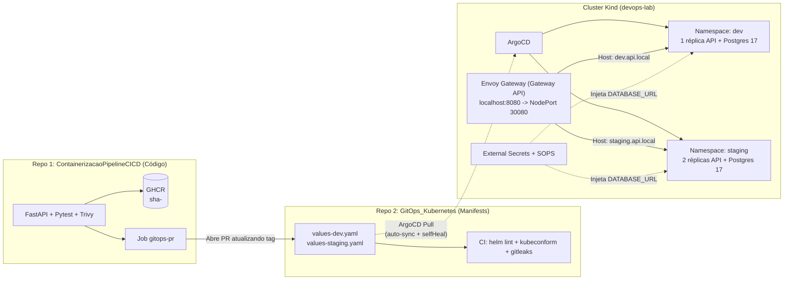
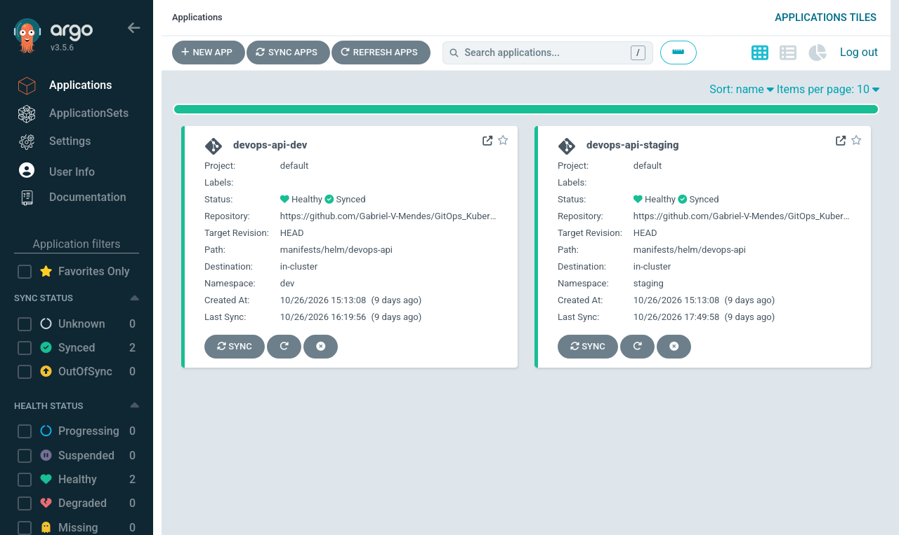
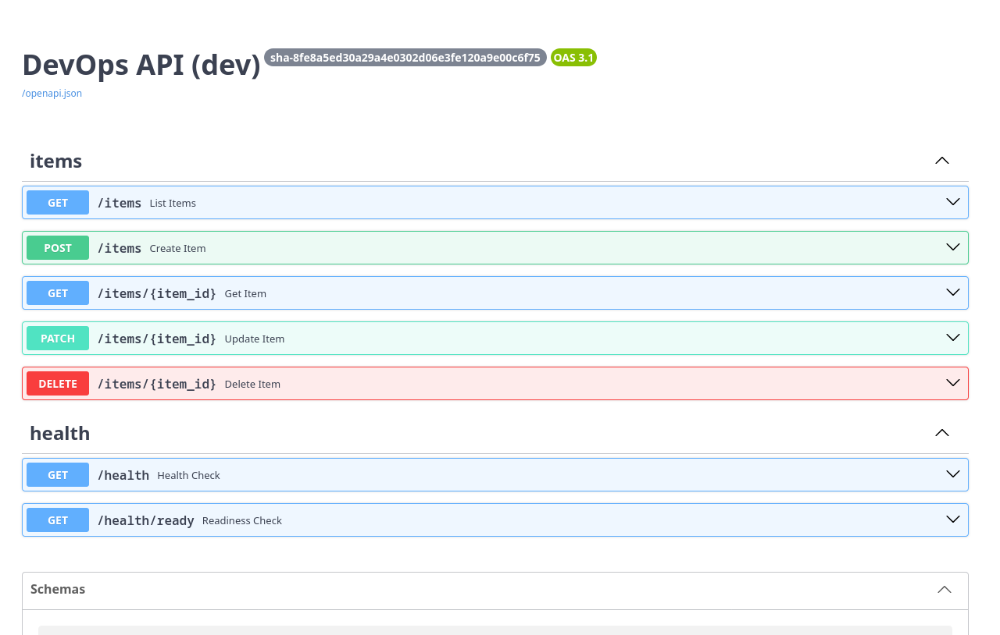

# Projeto 3 · GitOps em Kubernetes com ArgoCD, Gateway API e External Secrets

[](https://github.com/Gabriel-V-Mendes/GitOps_Kubernetes/actions/workflows/ci.yml)

Repositório dedicado de **manifests Kubernetes e GitOps** para a [**API do Projeto 1 (`ContainerizacaoPipelineCICD`)**](https://github.com/Gabriel-V-Mendes/ContainerizacaoPipelineCICD) (FastAPI + PostgreSQL 17, imagem non-root `UID 10001`). O estado desejado dos ambientes **`dev`** e **`staging`** vive exclusivamente neste repositório e é reconciliado continuamente dentro de um cluster **`kind`** pelo **ArgoCD**.

---

## 1. O que mudou (Arquitetura Atualizada)

| Antes (Versão Antiga) | Depois (Esta Versão) | Por quê |
|---|---|---|
| Aplicação HTML estática (`nginx:alpine`) misturada no mesmo repositório | **Repositório separado de manifests** consumindo a imagem real da **API do Projeto 1** (`ghcr.io/gabriel-v-mendes/containerizacaopipelinecicd:sha-...`) | Isola o ciclo de vida de código (CI) do estado declarativo do cluster (CD/GitOps) e evita loops de trigger |
| **Ingress NGINX** (`networking.k8s.io/v1/Ingress`) + configs órfãs do Istio | Começa com **`kubectl port-forward`** e expõe via **Gateway API (`gateway.networking.k8s.io/v1`)** usando **Envoy Gateway** | O Ingress NGINX foi aposentado pelo Kubernetes SIG Network. A Gateway API separa responsabilidades (`GatewayClass` / `Gateway` / `HTTPRoute`) e suporta divisão de tráfego nativa |
| `templates/secret.yaml` com `API_TOKEN` em Base64 commitado no Git | **Zero segredos reais; falsos positivos históricos listados no `.gitleaksignore`:** **SOPS (`age`)** criptografa a semente e o **External Secrets Operator (ESO)** sintetiza o `Secret` com `DATABASE_URL` lendo um `Secret` do próprio cluster (**padrão de laboratório**, não um gestor externo de segredos) | Base64 não é criptografia. Com SOPS + ESO, nenhum `kind: Secret` em texto puro existe em `manifests/` (validado por CI e Gitleaks) |
| Dependência implícita de subcharts externos | **Zero charts da Bitnami:** `StatefulSet` próprio do PostgreSQL 17 (`postgres:17-alpine` fixado por digest) dentro do Helm chart | A Bitnami restringiu seu catálogo gratuito de imagens e charts de terceiros adicionam complexidade opaca |
| `kind: Rollout` obrigatório sem `Deployment` e sem probes | **`Deployment` padrão** com `livenessProbe` (`/health`), `readinessProbe` (`/health/ready`) e `resources` (`requests`/`limits`). **Argo Rollouts** virou **desafio opcional** (`rollout.enabled: true`) | Canário real exige divisão percentual de tráfego (via pesos na `HTTPRoute`); sem isso, o Rollout apenas escala réplicas |
| CI dava `git push` direto na `main` | **Fluxo via Pull Request:** o pipeline abre uma PR atualizando `image.tag` em `values-dev.yaml`, que passa por validação antes do merge | Preserva governança, revisão de código e checks obrigatórios (`helm lint`, `kubeconform`, `gitleaks`) |

---

## 2. Arquitetura GitOps (2 Repositórios)



### Estrutura do Repositório

```text
.
├── .github/
│   ├── dependabot.yml                      # Atualização semanal dos SHAs das GitHub Actions
│   └── workflows/
│       ├── ci.yml                          # Gitleaks + proíbe kind:Secret + helm lint + kubeconform (CRDs reais)
│       └── update-image-pr.yml             # Abre PR automatizado atualizando a tag da imagem
├── .gitleaksignore                         # Falsos positivos históricos de commits legados já removidos
├── .sops.yaml                              # Regra de criptografia AES-256-GCM (age) para data/stringData
├── Makefile                                # Atalhos: bootstrap, restore, smoke, drift, canary, lint, secrets
├── schemas/                                # JSON Schemas reais dos CRDs (HTTPRoute, ExternalSecret, Rollout, Application...)
├── infrastructure/
│   ├── kind/kind-config.yaml               # Cluster Kind mapeando 127.0.0.1:8080 -> NodePort 30080
│   ├── gateway/envoy-gateway.yaml          # EnvoyProxy (NodePort 30080) + GatewayClass + Gateway
│   ├── external-secrets/                   # RBAC mínimo + ClusterSecretStore (provider kubernetes — padrão de lab)
│   ├── secrets/postgres-source-secret.sops.yaml # Semente criptografada com SOPS + age (ENC[AES256_GCM...])
│   ├── argocd/namespace.yaml               # Namespace do ArgoCD (instalado na versão explícita v3.5.6)
│   ├── monitoring/                         # Stack opcional Prometheus/Grafana
│   └── rollouts/namespace.yaml             # Namespace e plugin Gateway API v0.17.0 para Argo Rollouts v1.7.2
├── manifests/
│   ├── argocd/
│   │   ├── application-dev.yaml            # Application dev (auto-sync, prune: true, selfHeal: true)
│   │   ├── application-staging.yaml        # Application staging (auto-sync, prune: true, selfHeal: true)
│   │   └── kustomization.yaml              # Aplica ambos os ambientes de uma vez
│   └── helm/devops-api/                    # Helm Chart da API do Projeto 1 (zero Bitnami)
│       ├── Chart.yaml
│       ├── values.yaml                     # Defaults (probes, requests/limits, securityContext UID 10001)
│       ├── values-dev.yaml                 # Overrides de dev (1 réplica, dev.api.local)
│       ├── values-staging.yaml             # Overrides de staging (2 réplicas, staging.api.local)
│       └── templates/
│           ├── deployment.yaml             # Deployment + initContainer wait-for-postgres + probes
│           ├── service.yaml                # Service ClusterIP (porta 8000)
│           ├── postgres-statefulset.yaml   # PostgreSQL 17-alpine oficial com PVC e probes pg_isready
│           ├── postgres-service.yaml       # Service interno do PostgreSQL (porta 5432)
│           ├── externalsecret.yaml         # ExternalSecret que monta DATABASE_URL sem expor senha no Git
│           ├── httproute.yaml              # HTTPRoute oficial da Gateway API (gateway.networking.k8s.io/v1)
│           ├── networkpolicy.yaml          # Isola API (só Gateway) e Postgres (só pods da API)
│           ├── hpa.yaml                    # HorizontalPodAutoscaler opcional
│           └── rollout.yaml                # Desafio opcional: Argo Rollouts + Gateway API traffic routing
├── scripts/
│   ├── bootstrap.sh                        # Provisiona/restaura todo o cluster a partir do Git
│   ├── smoke-test.sh                       # Valida etapa 1 (port-forward) e etapa 2 (Gateway API)
│   ├── demo-drift.sh                       # Introduz drift manual no cluster e prova o self-heal do ArgoCD
│   └── open-image-pr.sh                    # Cria branch e abre PR atualizando a tag da imagem
└── docs/
    ├── adr/001-kind-cluster-local.md
    ├── adr/002-gateway-api-controller.md   # Pesquisa comparativa de controllers Gateway API no Kind
    ├── adr/003-secrets-management-no-bitnami.md
    ├── diagrams/architecture.md
    └── runbooks/cluster-recovery.md
```

---

## 3. Pesquisa e Escolha do Controller de Gateway API para `kind`

Antes de substituir o Ingress NGINX, pesquisamos o comportamento dos principais controllers da **Gateway API (`gateway.networking.k8s.io/v1`)** num cluster `kind` sem MetalLB (detalhes completos em [`docs/adr/002-gateway-api-controller.md`](docs/adr/002-gateway-api-controller.md)):

| Controller | Conformidade Gateway API | Suporte a `NodePort` fixo no `kind` (`extraPortMappings`) | Consumo de RAM | Veredito |
|---|---|---|---|---|
| **Envoy Gateway** (`v1.10.0`) | Total (CNCF oficial) | **Nativo via CRD `EnvoyProxy`** (`nodePort: 30080` mapeado para `localhost:8080`) | ~110 MB | **Escolhido** |
| **NGINX Gateway Fabric** | Core | Bom via `NginxProxy`, porém acopla plano de controle e dados por Gateway | ~90 MB | Alternativa viável |
| **Traefik v3** | Core | Bom via Helm values, mas mistura CRDs proprietários (`IngressRoute`) | ~65 MB | Bom para setups simples |
| **Cilium / Istio** | Core + Mesh | Exige substituir CNI ou gerenciar LoadBalancers pendentes | 350–400 MB+ | Pesado demais para lab local |

---

## 4. Como Subir Tudo do Zero (e Testar `port-forward` + Gateway API)

Pré-requisitos: `docker`, `kind`, `kubectl`, `helm`, `sops` e `age`.

```bash
make bootstrap     # ou: ./scripts/bootstrap.sh
```

O script cria o cluster `kind`, carrega a imagem da API do Projeto 1 e instala toda a pilha com **versões explicitamente fixadas** para garantir reprodutibilidade:
- **Envoy Gateway (`v1.10.0`)** via Helm OCI (`oci://docker.io/envoyproxy/gateway-helm --version v1.10.0`);
- **External Secrets Operator (`2.14.0`)** via Helm (`external-secrets/external-secrets --version 2.14.0`), descriptografando a semente com **SOPS + age** em memória;
- **Argo Rollouts (`v1.7.2`)** + **Gateway API Traffic Router Plugin (`v0.17.0`)** via URLs de release fixadas;
- **ArgoCD (`v3.5.6`)** via manifesto oficial com tag explícita (`https://raw.githubusercontent.com/argoproj/argo-cd/v3.5.6/manifests/install.yaml`), aplicando em seguida as `Application`s de **`dev`** e **`staging`**.

### Etapa 1: Acesso inicial via `kubectl port-forward`

```bash
kubectl port-forward -n dev svc/devops-api-dev 8000:8000
```

Em outro terminal:

```bash
curl -i http://127.0.0.1:8000/health
curl -i http://127.0.0.1:8000/health/ready
```

### Etapa 2: Acesso via Gateway API (`HTTPRoute` em `localhost:8080`)

O `Gateway` compartilhado escuta na porta `8080` do host (`NodePort 30080` do Kind) e roteia para `dev` ou `staging` de acordo com o header `Host`:

```bash
# Ambiente DEV (1 réplica)
curl -fsS -H "Host: dev.api.local" http://127.0.0.1:8080/health/ready
curl -fsS -H "Host: dev.api.local" -H "Content-Type: application/json" \
  -d '{"name":"Item em Dev","description":"Criado via Gateway API"}' \
  http://127.0.0.1:8080/items

# Ambiente STAGING (2 réplicas, banco isolado)
curl -fsS -H "Host: staging.api.local" http://127.0.0.1:8080/health/ready
curl -fsS -H "Host: staging.api.local" http://127.0.0.1:8080/items
```

Ou execute a bateria completa (Etapa 1 + Etapa 2) com um único comando:

```bash
make smoke
```

### Evidências Visuais do Cluster em Execução (ArgoCD + Gateway API)





---

## 5. Segredos Fora do Git (SOPS + External Secrets — Padrão de Laboratório)

**Status de segredos no repositório:** **zero segredos reais; falsos positivos históricos listados no [`.gitleaksignore`](.gitleaksignore)**.
Os 9 fingerprints registrados no `.gitleaksignore` correspondem exclusivamente a certificados de exemplo do pacote `istio-1.30.3/samples/` (commit `5563437`) e a um secret fictício de demonstração da primeira versão do chart (commit `2ed3eba`), ambos já removidos da árvore do repositório, permitindo que o **Gitleaks** audite todo o histórico (`fetch-depth: 0`) e bloqueie qualquer vazamento novo.

> [!IMPORTANT]
> **Padrão de Laboratório vs. Gestor Externo de Segredos em Produção:**
> Neste repositório, o **External Secrets Operator (ESO)** utiliza um `ClusterSecretStore` com o `provider.kubernetes` ([`infrastructure/external-secrets/cluster-secret-store.yaml`](infrastructure/external-secrets/cluster-secret-store.yaml)) que **lê um `Secret` semente (`postgres-source-secret`) do próprio cluster** (no namespace isolado `external-secrets`). **Isso é um padrão de laboratório local, não um gestor externo de segredos.** Essa escolha permite que qualquer avaliador execute `make bootstrap` localmente no `kind` sem precisar de conta paga na nuvem (AWS/GCP) ou de um servidor Vault externo, enquanto exercita o CRD real `ExternalSecret` e a montagem dinâmica de templates. **Em produção**, o template [`externalsecret.yaml`](manifests/helm/devops-api/templates/externalsecret.yaml) da aplicação permanece inalterado e apenas o `ClusterSecretStore` é apontado para um gestor externo real (**AWS Secrets Manager**, **GCP Secret Manager** ou **HashiCorp Vault**) autenticado via IAM Roles for Service Accounts (IRSA) / Workload Identity.

Como o fluxo opera no laboratório:
1. **No Git (`infrastructure/secrets/postgres-source-secret.sops.yaml`):** os campos sensíveis (`username`, `password`, `database`) ficam criptografados com **Mozilla SOPS + age (`AES-256-GCM`)**, conforme definido em [`.sops.yaml`](.sops.yaml). Nenhum arquivo `kind: Secret` em texto puro ou Base64 existe em `manifests/`.
2. **No Bootstrap (`scripts/bootstrap.sh`):** o comando `sops -d ... | kubectl apply -f -` descriptografa a semente apenas em memória e cria o Secret `postgres-source-secret` no namespace `external-secrets` (ou gera uma senha aleatória via `openssl rand -hex 20` caso a chave privada `age` não esteja presente na máquina).
3. **No Cluster (`ExternalSecret`):** o template [`externalsecret.yaml`](manifests/helm/devops-api/templates/externalsecret.yaml) instrui o **External Secrets Operator** a ler o `ClusterSecretStore` (`k8s-secret-store`) e sintetizar automaticamente os Secrets `devops-api-dev-db-secret` (em `dev`) e `devops-api-staging-db-secret` (em `staging`) com a string `DATABASE_URL` (`postgresql+psycopg://...`).
4. **Verificação no CI:** o job `Secret Scan & Policy` em [`.github/workflows/ci.yml`](.github/workflows/ci.yml) roda o **Gitleaks** em todo o histórico (`fetch-depth: 0`) e falha imediatamente se encontrar qualquer `kind: Secret` dentro de `manifests/`.

---

## 6. Demonstração de Configuration Drift & Self-Heal

As Applications do ArgoCD ([`application-dev.yaml`](manifests/argocd/application-dev.yaml) e [`application-staging.yaml`](manifests/argocd/application-staging.yaml)) possuem `automated.selfHeal: true` e `automated.prune: true`.

Para demonstrar o ArgoCD corrigindo uma alteração manual feita diretamente no cluster (`kubectl scale deployment devops-api-dev -n dev --replicas=4`):

```bash
make drift     # ou: ./scripts/demo-drift.sh
```

O que acontece passo a passo:
1. No Git (`values-dev.yaml`), `replicaCount` está declarado como **`1`**.
2. O script executa `kubectl scale deployment devops-api-dev -n dev --replicas=4` à mão no cluster.
3. O Kubernetes chega a iniciar 3 pods extras, mas o **ArgoCD detecta a divergência (`OutOfSync`)** em relação ao Git e, graças ao **`selfHeal: true`**, reaplica imediatamente `replicas: 1`, encerrando (`Terminating`) os pods excedentes e voltando o status para **`Synced` + `Healthy`**.

Saída real da execução no cluster `kind`:

```text
==================================================================
1. Estado inicial (declarado no Git: replicas=1)
==================================================================
NAME             SYNC STATUS   HEALTH STATUS   REVISION                                   PROJECT
devops-api-dev   Synced        Healthy         a23353dd40cc626d607180b8dd21fac1eb75aaaa   default
NAME             READY   UP-TO-DATE   AVAILABLE   AGE
devops-api-dev   1/1     1            1           5m1s

==================================================================
2. Causando DRIFT manual no cluster (kubectl scale --replicas=4)
==================================================================
deployment.apps/devops-api-dev scaled
deployment.apps/devops-api-dev annotated
Estado imediatamente após a alteração manual (drift introduzido):
NAME             READY   UP-TO-DATE   AVAILABLE   AGE
devops-api-dev   1/4     4            1           5m1s
NAME                              READY   STATUS     RESTARTS   AGE
devops-api-dev-5946b5559c-24vj8   0/1     Init:0/1   0          0s
devops-api-dev-5946b5559c-grwcv   0/1     Init:0/1   0          0s
devops-api-dev-5946b5559c-lw6dw   0/1     Init:0/1   0          0s
devops-api-dev-5946b5559c-qr4kl   1/1     Running    0          5m1s

==================================================================
3. Aguardando o ArgoCD (selfHeal: true) corrigir o drift...
==================================================================
[1s] Application sync=Synced | Deployment spec.replicas=4
[2s] Application sync=Synced | Deployment spec.replicas=4
[3s] Application sync=Synced | Deployment spec.replicas=4
[4s] Application sync=Synced | Deployment spec.replicas=1

✅ Drift corrigido automaticamente pelo ArgoCD!

==================================================================
4. Estado final restaurado (idêntico ao Git: replicas=1)
==================================================================
NAME             SYNC STATUS   HEALTH STATUS   REVISION                                   PROJECT
devops-api-dev   Synced        Healthy         a23353dd40cc626d607180b8dd21fac1eb75aaaa   default
NAME             READY   UP-TO-DATE   AVAILABLE   AGE
devops-api-dev   1/1     1            1           5m8s
NAME                              READY   STATUS        RESTARTS   AGE
devops-api-dev-5946b5559c-24vj8   0/1     Terminating   0          7s
devops-api-dev-5946b5559c-grwcv   0/1     Terminating   0          7s
devops-api-dev-5946b5559c-lw6dw   0/1     Terminating   0          7s
devops-api-dev-5946b5559c-qr4kl   1/1     Running       0          5m8s
```

---

## 7. Disaster Recovery: Apagar o Cluster e Restaurar Só a Partir do Git

Como todo o estado desejado está versionado no Git, o cluster `kind` é tratado como **gado (cattle), não como pet**:

```bash
make restore
```

Esse comando executa em sequência:
1. `kind delete cluster --name devops-lab` — destrói completamente todos os nós, containers e volumes do cluster.
2. `./scripts/bootstrap.sh` — recria o cluster `kind`, instala Envoy Gateway, External Secrets + semente SOPS e ArgoCD, e aplica `manifests/argocd`. O ArgoCD baixa o Helm chart do Git e recria os bancos PostgreSQL 17, Secrets, Services, Deployments e HTTPRoutes em `dev` e `staging`.
3. `./scripts/smoke-test.sh` — comprova que a API responde `200 OK` tanto via `port-forward` quanto via Gateway API em `dev.api.local` e `staging.api.local`.

---

## 8. Pipeline Abrindo Pull Request com a Nova Tag da Imagem

Em vez de o CI fazer commit direto na branch `main`, a atualização de imagem segue o fluxo de Pull Request:

1. **No repositório da API ([`ContainerizacaoPipelineCICD/.github/workflows/ci.yml`](https://github.com/Gabriel-V-Mendes/ContainerizacaoPipelineCICD/blob/main/.github/workflows/ci.yml)):** após o job `Build, Scan & Push` publicar a imagem `ghcr.io/gabriel-v-mendes/containerizacaopipelinecicd:sha-<commit>`, o job `gitops-pr` faz checkout deste repositório de manifests e executa `./scripts/open-image-pr.sh sha-<commit> dev`.
2. **Neste repositório ([`.github/workflows/update-image-pr.yml`](.github/workflows/update-image-pr.yml)):** também é possível disparar a abertura de PR via `repository_dispatch` ou manualmente (`workflow_dispatch`) informando a tag e o ambiente (`dev` ou `staging`).
3. **Validação na PR (incluindo CRDs reais no `kubeconform`):** antes do merge, o workflow [`ci.yml`](.github/workflows/ci.yml) (com todas as Actions fixadas por commit SHA) executa `helm lint`, verifica probes/limites, garante ausência de segredos e valida todos os **26 recursos renderizados e de infraestrutura** no **`kubeconform -strict` sem `-ignore-missing-schemas` (`Skipped: 0`)**, validando `HTTPRoute`, `ExternalSecret`, `Rollout`, `Application`, `Gateway`, `GatewayClass`, `EnvoyProxy` e `ClusterSecretStore` contra seus JSON Schemas reais versionados em [`schemas/`](schemas/) e contra o catálogo da comunidade (`datreeio/CRDs-catalog`) fixado por commit SHA imutável (`49729e4`). Após o merge na `main`, o ArgoCD detecta o novo commit e atualiza o cluster automaticamente.

* **Evidência do CI (GitHub Actions) e de PR Automatizada de Imagem:**
  - **Run Verde do CI:** [Run #42221471943 no GitHub Actions](https://github.com/Gabriel-V-Mendes/GitOps_Kubernetes/actions/runs/42221471943) (jobs de `Secret Scan & Policy` e `Helm Lint & Schema Validation` aprovados, com os 26 recursos e CRDs validados no `kubeconform -strict` sem skips).
  - **PR de Atualização de Tag (`open-image-pr.sh`):** [PR #1 (`chore(dev): update image tag to sha-8fe8a5ed30a29a4e0302d06e3fe120a9e00c6f75`)](https://github.com/Gabriel-V-Mendes/GitOps_Kubernetes/pull/1).

---

## 9. Deploy por Push vs Deploy por Pull (GitOps)

No **Projeto 1** usamos **Deploy por Push** (GitHub Actions conectando via SSH na VPS e rodando `docker compose up`). Neste **Projeto 3** migramos para **Deploy por Pull (GitOps)** com o ArgoCD rodando dentro do cluster Kubernetes.

| Critério | Deploy por Push (CI empurra para o cluster) | Deploy por Pull / GitOps (ArgoCD puxa do Git) |
|---|---|---|
| **Quem inicia o deploy?** | O runner externo de CI (GitHub Actions) executa `kubectl apply` / `helm upgrade` / `ssh` contra o ambiente de destino | O agente interno (**ArgoCD**) dentro do cluster monitora o repositório Git e puxa as mudanças |
| **Credenciais e Superfície de Ataque** | **Alto risco:** o CI externo precisa guardar chaves SSH ou um `KUBECONFIG` com permissão de escrita (`cluster-admin`) no cluster. Se o CI vazar, o atacante ganha controle total de produção | **Menor privilégio:** a credencial do cluster **nunca sai do cluster**. O ArgoCD precisa apenas de permissão de **leitura** (`read-only`) no repositório Git e no registry de imagens |
| **Firewall / Rede** | O servidor/API Server do Kubernetes precisa aceitar conexões de entrada vindas dos IPs públicos dos runners do CI | O cluster não precisa expor o API Server para fora: o ArgoCD faz apenas conexões de saída (`HTTPS 443`) para o GitHub e GHCR |
| **Detecção de Drift e Self-Healing** | **Inexistente:** o CI só roda quando há `git push`. Se alguém alterar algo manualmente no servidor/cluster (`kubectl edit` / `scale`), o CI nunca fica sabendo | **Contínua:** o ArgoCD compara o estado vivo do cluster com o Git a cada ciclo. Qualquer alteração manual é detectada (`OutOfSync`) e revertida automaticamente (`selfHeal: true`) |
| **Disaster Recovery (Recriar Cluster)** | Exige reexecutar múltiplos pipelines de CI na ordem certa para reimplantar cada serviço | Basta subir um cluster limpo, instalar o ArgoCD e apontar para o repositório Git: todo o estado converge sozinho |
| **Auditoria e Rollback** | O estado real depende do histórico de logs de execuções da ferramenta de CI | `git log` é o histórico exato do cluster; um rollback é simplesmente um `git revert` via Pull Request |

---

## 10. Desafio Opcional: Argo Rollouts com Divisão de Tráfego

Por que o Argo Rollouts é opcional neste projeto?
Porque em Kubernetes puro (sem um controlador de roteamento que divida tráfego por porcentagem), os passos `setWeight` de um `Rollout` apenas aproximam a proporção pela quantidade de Pods (ex.: para fazer 10% canário seriam necessários 10 Pods).

Quando `rollout.enabled=true` (habilitado por padrão no ambiente **`staging`** em [`values-staging.yaml`](manifests/helm/devops-api/values-staging.yaml)), o chart:
1. Substitui o `Deployment` por um recurso `Rollout` ([`templates/rollout.yaml`](manifests/helm/devops-api/templates/rollout.yaml));
2. Cria o serviço `devops-api-<env>-canary`;
3. Adiciona o `backendRef` canário na `HTTPRoute` ([`templates/httproute.yaml`](manifests/helm/devops-api/templates/httproute.yaml)) para que o plugin `argoproj-labs/gatewayAPI` ([`infrastructure/rollouts/namespace.yaml`](infrastructure/rollouts/namespace.yaml)) controle a divisão exata de tráfego HTTP (`weight: 80/20`, `50/50`, `100/0`) no Envoy Gateway, independentemente do número de Pods.

Para demonstrar a progressão Canário ao vivo no cluster:

```bash
make canary     # ou: ./scripts/demo-canary.sh
```

Saída real da execução no ambiente `staging`:

```text
[7s] Rollout: Progressing (step 0) | HTTPRoute weights: devops-api-staging=100% devops-api-staging-canary=0% 
[8s] Rollout: Paused (step 1) | HTTPRoute weights: devops-api-staging=80% devops-api-staging-canary=20% 
[14s] Rollout: Paused (step 3) | HTTPRoute weights: devops-api-staging=50% devops-api-staging-canary=50% 
[21s] Rollout: Progressing (step 4) | HTTPRoute weights: devops-api-staging=50% devops-api-staging-canary=50% 
[27s] Rollout: Healthy (step 5) | HTTPRoute weights: devops-api-staging=100% devops-api-staging-canary=0% 

✅ Promoção Canário (20% -> 50% -> 100%) concluída com sucesso!
```

---

## 11. Decisões e Trade-offs

| Decisão | Alternativa avaliada | Por quê / Trade-off |
|---|---|---|
| **2 repositórios separados** (Código no Projeto 1 vs Manifests aqui) | Monorepo (código + manifests juntos) | Evita loops infinitos de CI e isola permissões: o ArgoCD só lê o repo de manifests. Em troca, exige automação (`open-image-pr.sh`) para abrir PR de atualização de tag entre repositórios |
| **Gateway API (`Envoy Gateway v1.10.0`)** com `EnvoyProxy` NodePort `30080` | Ingress NGINX legado, Traefik, Cilium, Istio | O Ingress NGINX foi aposentado pelo SIG Network. O Envoy Gateway é padrão CNCF, consome ~110 MB de RAM e permite fixar `NodePort 30080` declarativamente para casar com o `extraPortMappings` do `kind` sem precisar de MetalLB |
| **SOPS (`age`) + External Secrets Operator (ESO `2.14.0`) lendo Secret semente do cluster** | `kind: Secret` Base64 no Git, Sealed Secrets (Bitnami), Vault externo obrigatório | **Padrão de laboratório:** o `ClusterSecretStore` lê um `Secret` semente (`postgres-source-secret`, descriptografado em memória via SOPS) do próprio cluster, não sendo um gestor externo de segredos. Isso mantém o laboratório `kind` 100% reproduzível sem exigir conta AWS/GCP, enquanto valida o contrato real do `ExternalSecret`. Em produção, troca-se apenas o provider do `ClusterSecretStore` para AWS Secrets Manager / GCP SM / Vault |
| **Versões explícitas no bootstrap (`ArgoCD v3.5.6`, `ESO 2.14.0`, `Envoy Gateway v1.10.0`, `Rollouts v1.7.2`), Actions e catálogo de schemas por SHA** | `stable/manifests/install.yaml`, Helm sem `--version`, catálogo comunitário em branch `main` e tags móveis `@v4` | Garante reprodutibilidade determinística do cluster e protege o pipeline contra ataques de supply chain em tags e branches mutáveis |
| **Validação de CRDs no `kubeconform -strict` com schemas reais (`schemas/` + catálogo comunitário fixado por commit SHA `49729e4`)** | `kubeconform -ignore-missing-schemas` ou catálogo em branch `main` móvel | Sem schemas dos CRDs, o `kubeconform` simplesmente ignorava `HTTPRoute`, `ExternalSecret` e `Rollout`. Com os schemas JSON reais versionados em `schemas/` priorizados e o catálogo `datreeio/CRDs-catalog` fixado por commit SHA imutável, os 26 recursos são validados com `Skipped: 0` e builds 100% determinísticos |
| **`StatefulSet` próprio do PostgreSQL 17-alpine** no Helm chart | Subchart `bitnami/postgresql` | Elimina dependência do catálogo restrito da Bitnami e dá controle explícito sobre probes (`pg_isready`), `securityContext` e `PersistentVolumeClaim` |
| **ArgoCD em modo Pull (`selfHeal: true` + `prune: true`)** | Deploy por Push (`kubectl apply` no GitHub Actions) | Credenciais de admin do cluster nunca saem do cluster e qualquer alteração manual (`kubectl scale/edit`) é revertida automaticamente em segundos |
| **Argo Rollouts opcional (`rollout.enabled`)** integrado à Gateway API | `Rollout` obrigatório sem controlador de tráfego | Sem roteador HTTP que divida tráfego por peso (`weight`), um `Rollout` apenas escala réplicas. Com o plugin `argoproj-labs/gatewayAPI`, `staging` faz canário real (`80/20` → `50/50` → `100/0`) na `HTTPRoute` |

---

## 12. Custo Estimado

Valores de referência em **outubro/2026** (sem impostos):

| Cenário | Componentes | Custo Mensal Estimado | Observação |
|---|---|---|---|
| **1. Laboratório Local (`kind` — padrão deste repo)** | Cluster `kind` (`devops-lab`) + Envoy Gateway + ArgoCD + ESO + 2 ambientes (`dev` e `staging`) | **US$ 0,00 / mês** | Roda 100% em Docker local (~1,6 GB de RAM total consumida pelo container do nó `kind`) |
| **2. CI/CD e Registry (GitHub público)** | GitHub Actions (`helm lint`, `kubeconform`, `gitleaks`), GHCR e Dependabot | **US$ 0,00 / mês** | Gratuito para repositórios públicos |
| **3. Kubernetes em VPS única (K3s em Hetzner CX32)** | 4 vCPU, 8 GB RAM, 80 GB NVMe rodando a mesma pilha (ArgoCD + Envoy Gateway + ESO + Postgres) | **≈ € 11,50 / mês (~US$ 12,50)** | Opção de baixo custo para manter `dev` + `staging` 24/7 na nuvem sem pagar taxa de control-plane gerenciado |
| **4. Kubernetes Gerenciado (AWS EKS / GCP GKE)** | Control plane EKS (US$ 73) + 2 nós `t3.medium` Spot/Saving Plans (~US$ 35) + NLB (~US$ 18) | **≈ US$ 126,00 / mês** | Recomendado apenas quando houver múltiplos times ou exigência de SLA gerenciado do control-plane |

---

## 13. O que eu faria diferente

1. **Plugin KSOPS ou Cofre de Nuvem (AWS Secrets Manager / HashiCorp Vault) em Produção:** hoje o `bootstrap.sh` descriptografa o "Secret Zero" (`postgres-source-secret.sops.yaml`) com `sops` + `age` em memória e alimenta o `ClusterSecretStore` local. Em nuvem, eu apontaria o `ClusterSecretStore` diretamente para o AWS Secrets Manager / GCP Secret Manager com autenticação via **Workload Identity / IRSA**, eliminando até mesmo o Secret semente.
2. **ApplicationSet no lugar de Applications individuais:** temos `application-dev.yaml` e `application-staging.yaml` separados por clareza didática. Com 5+ ambientes ou múltiplos microsserviços, um único `ApplicationSet` com Matrix/List Generator reduziria repetição.
3. **Análise Automatizada no Canary (`AnalysisTemplate` no Argo Rollouts):** o `Rollout` em `staging` faz pausas temporizadas (`pause: 15s`) nos passos de `20%` e `50%`. Conectando um `AnalysisTemplate` ao Prometheus (Projeto 4), o Rollout promoveria ou faria rollback automático com base na taxa de erros `5xx` e na latência `p95`.
4. **TLS Automático na Gateway API com `cert-manager`:** hoje o listener do `Gateway` opera em HTTP na porta `80` (`localhost:8080`). Adicionar o `cert-manager` emitindo certificados (autoassinados localmente ou Let's Encrypt em produção) no listener HTTPS (`8443 -> 30443`) fecharia a criptografia em trânsito na borda.
5. **Políticas de Admissão com Kyverno ou OPA Gatekeeper:** além de validar probes e `requests/limits` no CI, um controlador de admissão no cluster bloquearia qualquer workload fora do padrão mesmo se aplicado fora do fluxo GitOps.

---

## 14. Série Completa do Portfólio DevOps & SRE (5 Projetos Conectados)

| # | Projeto | Repositório Oficial | CI Status |
|:---:|---|---|---|
| **1** | **Containerização & Pipeline CI/CD (DevSecOps)** | [`Gabriel-V-Mendes/ContainerizacaoPipelineCICD`](https://github.com/Gabriel-V-Mendes/ContainerizacaoPipelineCICD) | [](https://github.com/Gabriel-V-Mendes/ContainerizacaoPipelineCICD/actions/workflows/ci.yml) |
| **2** | **Infraestrutura AWS com OpenTofu & Floci (FinOps + OIDC)** | [`Gabriel-V-Mendes/infraestrutura-aws-opentofu-floci`](https://github.com/Gabriel-V-Mendes/infraestrutura-aws-opentofu-floci) | [](https://github.com/Gabriel-V-Mendes/infraestrutura-aws-opentofu-floci/actions/workflows/infra-ci.yml) |
| **3** | **GitOps & Kubernetes (ArgoCD + Helm + Gateway API + SOPS/ESO)** *(este repo)* | [`Gabriel-V-Mendes/GitOps_Kubernetes`](https://github.com/Gabriel-V-Mendes/GitOps_Kubernetes) | [](https://github.com/Gabriel-V-Mendes/GitOps_Kubernetes/actions/workflows/ci.yml) |
| **4** | **Observabilidade & SRE (Prometheus + Grafana Alloy + Loki + Alertmanager)** | [`Gabriel-V-Mendes/Observabilidade`](https://github.com/Gabriel-V-Mendes/Observabilidade) | [](https://github.com/Gabriel-V-Mendes/Observabilidade/actions/workflows/ci.yml) |
| **5** | **Platform Engineering & Golden Path (IDP + Reusable Workflows + TF Modules)** | [`Gabriel-V-Mendes/platform-engineering`](https://github.com/Gabriel-V-Mendes/platform-engineering) | [](https://github.com/Gabriel-V-Mendes/platform-engineering/actions/workflows/ci.yml) |

